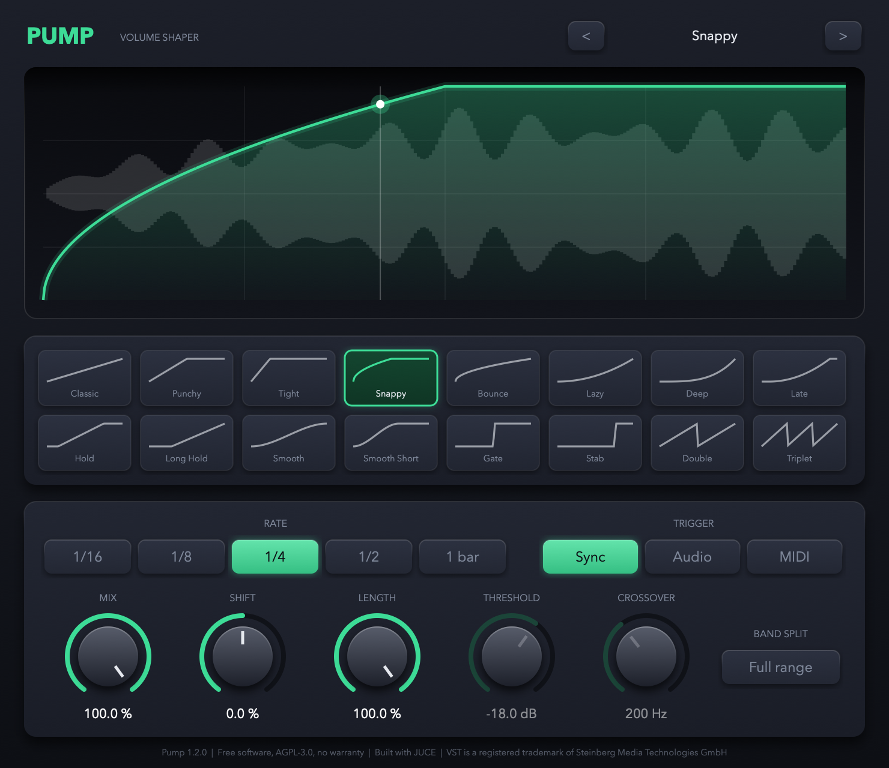
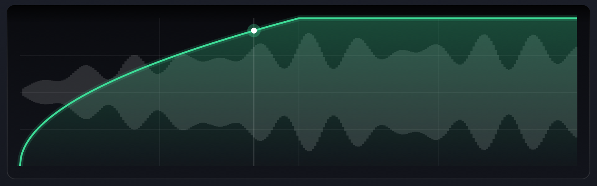
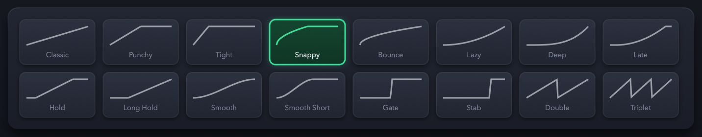
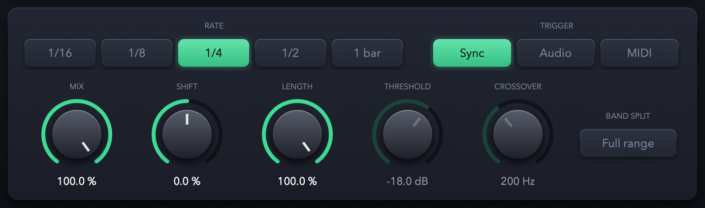
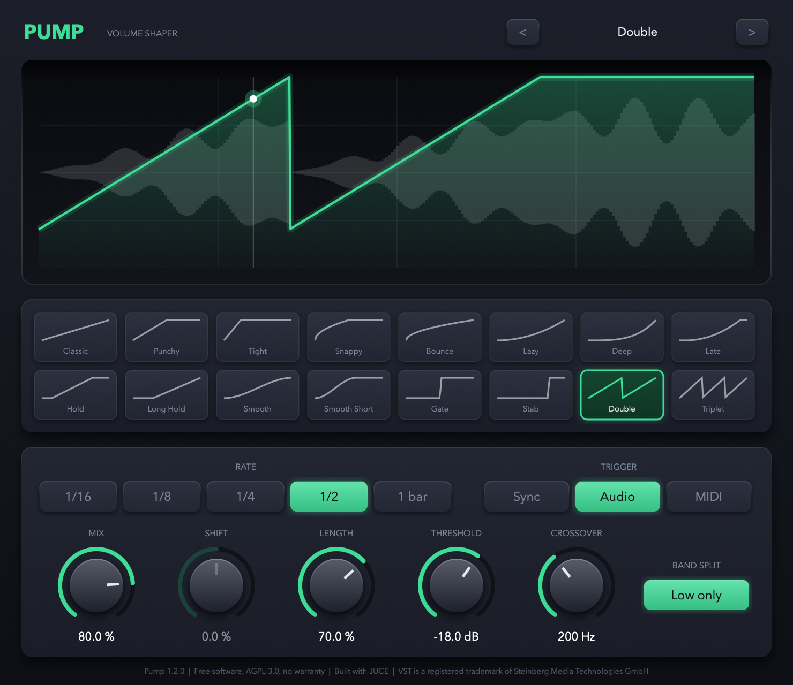

# Pump

**The sidechain pump, without the sidechain.**

You know the sound: the bass and pads duck out of the way every time the kick hits, and the whole track starts to breathe. Normally you get it by routing a compressor to the kick. Pump gives you the same movement by simply shaping the volume in time with your song. Put it on a track, pick a shape, done.

It's a free VST3 effect for Windows and macOS (Intel and Apple Silicon), made with FL Studio in mind.



## Get it

1. Go to the [latest release](../../releases/latest) and download the installer for your computer.
2. Run it.
3. In FL Studio, open **Options → File → Manage plugins** and click **Find installed plugins**. Pump shows up under Effects.

| Your computer | Download | The first time you run it |
|---|---|---|
| Windows | `Pump-Windows-Installer.exe` | Windows shows a blue warning. Click **More info**, then **Run anyway**. |
| Mac | `Pump-macOS-Installer.pkg` | Right-click the file and choose **Open**. If macOS still refuses, go to System Settings → Privacy & Security and click **Open Anyway**. |

Those warnings appear because the installers aren't signed with a paid developer certificate. The installers only copy one file, `Pump.vst3`, into your plugin folder.

When a newer version comes out, an **Update available** button appears at the top of the plugin. It takes you to the download page; run the new installer over the old one.

## Using it

### The display



The green line is the volume over one cycle: low means quiet, high means full volume. Behind it you see your own audio, so you can watch the duck happen. The dot follows the song as it plays. When the song is stopped, Pump rests and leaves your sound alone.

### Shapes



Sixteen shapes, each drawn the way it sounds. Click one to use it, or step through them with the arrows at the top.

- **Classic, Punchy, Tight, Snappy, Bounce** — the everyday kick duck, from long to very short
- **Lazy, Deep, Late** — the volume stays down longer and comes back slowly
- **Hold, Long Hold** — full silence for a moment before the volume returns
- **Smooth, Smooth Short** — gentle, rounded movement
- **Gate, Stab** — hard on/off chops
- **Double, Triplet** — two or three ducks per cycle

### Controls



| Control | What it does |
|---|---|
| **Rate** | How long one cycle lasts. `1/4` ducks on every beat, which is what you want for a four-on-the-floor kick. |
| **Trigger** | What starts the duck. **Sync** follows the song's tempo. **Audio** ducks whenever another track (your kick) hits. **MIDI** ducks whenever a note arrives. |
| **Mix** | How deep the duck goes. 100% is full silence at the bottom; lower is subtler. |
| **Shift** | Slides the duck a little earlier or later, to line it up with your kick. |
| **Length** | Shortens the shape so the volume is back sooner. |
| **Threshold** | In Audio mode, how loud the kick must be to set off a duck. |
| **Band split** | **Full range** ducks everything. **Low only** ducks just the bass and leaves the top end untouched. |
| **Crossover** | Where "bass" ends when Band split is on Low only. |

### Ducking to your own kick

Sync is all most tracks need. If your kick pattern isn't a steady beat, let the kick itself trigger Pump:



**From audio (FL Studio)**

1. In the mixer, select the kick's track.
2. Right-click the small arrow at the bottom of the track Pump is on and choose **Sidechain to this track**.
3. Open Pump, click the gear icon, go to the **Processing** tab and pick that track as the sidechain input.
4. Set **Trigger** to **Audio** and adjust **Threshold** until every kick sets off a duck.

**From MIDI (FL Studio)**

1. Open Pump, click the gear icon and give it a **MIDI input port** number.
2. Add a **MIDI Out** channel set to the same port.
3. Set **Trigger** to **MIDI**. Every note you send starts a duck.

## Removing it

Delete `Pump.vst3` from:

- Windows: `C:\Program Files\Common Files\VST3\`
- Mac: `/Library/Audio/Plug-Ins/VST3/`

## Privacy

When you open its window, Pump asks GitHub whether a newer release exists. That's the only time it goes online, and it sends nothing about you or your music.

## For developers

You need CMake 3.22 or newer and a C++17 compiler (Xcode command line tools or Visual Studio). JUCE downloads itself the first time.

```bash
cmake -B build -DCMAKE_BUILD_TYPE=Release
```

```bash
cmake --build build --config Release
```

```bash
ctest --test-dir build -C Release
```

The plugin ends up in `build/Pump_artefacts/Release/VST3/`.

| File | What's in it |
|---|---|
| `Source/Duck.h` | The shapes and the volume maths |
| `Source/PumpProcessor.h` | The audio engine: triggers, band split, timing |
| `Source/PluginProcessor.cpp` | The window you see |
| `Source/Version.h` | Version comparison for the update check |
| `Source/test_*.cpp` | Tests |
| `installer.iss` | The Windows installer |

To publish a new version, bump `VERSION` in `CMakeLists.txt` and push a tag. GitHub builds and tests both installers and attaches them to a new release.

```bash
git tag v1.3.0 && git push --tags
```

## License and credits

Pump is free software under the [GNU Affero General Public License v3](LICENSE). You can use it in any music you make, commercial or not, with no strings attached to your songs. If you share a modified version of the plugin itself, you have to share your source code under the same license. It comes with no warranty.

Built with [JUCE](https://juce.com), used under the AGPLv3. VST is a registered trademark of Steinberg Media Technologies GmbH. FL Studio is a trademark of Image-Line. Pump is an independent project and is not affiliated with or endorsed by either company.
